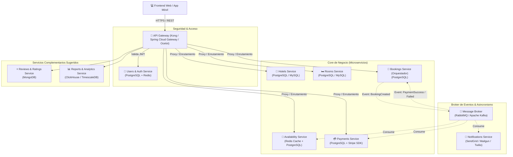
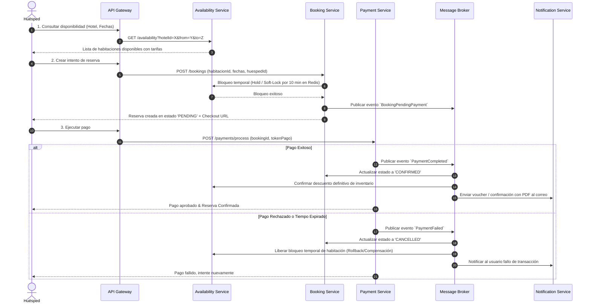

# 🏨 Sistema de Gestión y Reservas Hoteleras (Cloud-Native Microservices)

Plataforma escalable basada en una arquitectura de **microservicios**, orientada a eventos (*Event-Driven Architecture*) y con tolerancia a fallos para administrar hoteles, tipos de habitaciones, inventario en tiempo real, huéspedes, reservas, transacciones de pago y notificaciones automáticas.

---

## 📑 Tabla de Contenidos
1. [Descripción General](#-descripción-general)
2. [Arquitectura del Sistema](#-arquitectura-del-sistema)
   - [Diagrama de Arquitectura](#diagrama-de-arquitectura)
   - [Flujo de Reserva y Patrón Saga](#flujo-de-reserva-y-patrón-saga)
3. [Catálogo de Microservicios](#-catálogo-de-microservicios)
   - [Microservicios Base (Requeridos)](#microservicios-base-requeridos)
   - [Microservicios Adicionales Recomendados](#microservicios-adicionales-recomendados-para-elevar-el-proyecto)
4. [Stack Tecnológico Recomendado](#-stack-tecnológico-recomendado)
5. [Patrones de Arquitectura Clave](#-patrones-de-arquitectura-clave)
6. [Estrategia para Evitar Overbooking (Doble Reserva)](#-estrategia-para-evitar-overbooking-doble-reserva)
7. [Funcionalidades de Alto Valor para Destacar](#-funcionalidades-de-alto-valor-para-destacar)
8. [Estructura del Proyecto (Monorepo)](#-estructura-del-proyecto-monorepo)
9. [Hojas de Ruta / Pasos de Implementación](#-hoja-de-ruta-de-implementación)

---

## 📌 Descripción General

El **Sistema de Reservas Hoteleras** permite a:
- **Huéspedes / Clientes:** Buscar hoteles y habitaciones con filtros por fechas, capacidad, amenidades y rango de precio; consultar disponibilidad en tiempo real, reservar con checkout seguro y recibir confirmaciones y recordatorios por correo.
- **Administradores / Hoteleros:** Gestionar la información del hotel, crear y actualizar inventario de habitaciones, definir temporadas y tarifas, visualizar el calendario de ocupación y reportes de facturación.

---

## 🏛 Arquitectura del Sistema

La solución adopta el patrón **Database per Service** para garantizar bajo acoplamiento e independencia de despliegue, junto con un **API Gateway** como punto único de entrada y un **Message Broker** para comunicación asíncrona entre servicios.

### Diagrama de Arquitectura



---

### Flujo de Reserva y Patrón Saga

Dado que una reserva involucra múltiples servicios (Bloqueo de Habitación $\rightarrow$ Creación de Reserva $\rightarrow$ Procesamiento de Pago $\rightarrow$ Confirmación de Inventario $\rightarrow$ Notificación), se utiliza el **Patrón Saga (Coreografía u Orquestación)** con transacciones compensatorias para evitar inconsistencias si el pago falla:



---

## 🧩 Catálogo de Microservicios

### Microservicios Base (Requeridos)

| # | Microservicio | Base de Datos | Responsabilidades Principales |
|---|---|---|---|
| 1 | **Usuarios (Users & Auth)** | PostgreSQL | Registro de clientes y recepcionistas/admins, login (JWT/OAuth2), gestión de perfiles de huéspedes, hashing de contraseñas (BCrypt/Argon2) y RBAC (roles y permisos). |
| 2 | **Hoteles (Hotels Service)** | PostgreSQL / MySQL | CRUD de hoteles, sedes, dirección georreferenciada (lat/long), políticas (check-in/check-out, mascotas, cancelación) y servicios del hotel (piscina, WiFi, etc.). |
| 3 | **Habitaciones (Rooms Service)** | PostgreSQL / MySQL | Catálogo de tipos de habitaciones (Suite, Deluxe, Estándar), capacidad (adultos, niños), camas, comodidades, fotos e inventario base por hotel. |
| 4 | **Disponibilidad (Availability)** | Redis + PostgreSQL | Calendario de ocupación en tiempo real por fecha y tipo de habitación, tarifas vigentes por día, bloqueo temporal (10-15 minutos) durante el checkout para evitar colisiones. |
| 5 | **Reservas (Bookings Service)** | PostgreSQL | Orquestación del ciclo de vida de la reserva (`PENDING`, `CONFIRMED`, `CANCELLED`, `COMPLETED`), historial de reservas del huésped, cálculo del importe total e impuestos. |
| 6 | **Pagos (Payments Service)** | PostgreSQL | Transacciones de cobro mediante pasarela (Stripe, Mercado Pago o PayPal en modo sandbox), manejo de Webhooks, generación de recibos/comprobantes y reembolsos en caso de cancelación. |
| 7 | **Notificaciones (Notifications)** | MongoDB / Ninguna (Stateless) | Envío de correos de confirmación con PDF, recordatorios de check-in, alertas de cancelación mediante SMTP (SendGrid, Mailtrap o Amazon SES) y SMS/WhatsApp (Twilio). |

---

### Microservicios Adicionales Recomendados (Para Elevar el Proyecto)

Para transformar un proyecto académico común en un **sistema de nivel profesional (Enterprise)**, se recomienda incorporar:

| # | Microservicio Adicional | BD / Herramienta | ¿Por qué agregarlo? |
|---|---|---|---|
| 8 | **API Gateway & Service Registry** | Spring Cloud Gateway / Kong / Ocelot + Eureka/Consul | Punto de entrada unificado, enrutamiento dinámico, limitación de peticiones (*Rate Limiting*), CORS unificado y validación centralizada de tokens JWT. |
| 9 | **Reseñas y Calificaciones (Reviews Service)** | MongoDB | Permite a huéspedes calificar su estancia con puntaje (1-5 estrellas) y comentarios con fotos. Almacenamiento ideal en documento NoSQL por flexibilidad de campos y alto volumen de lectura. |
| 10 | **Precios Dinámicos y Promociones (Pricing & Discounts)** | PostgreSQL + Redis | Permite ajustar tarifas según temporada (alta/baja), fines de semana, ocupación actual o códigos de cupón de descuento (`SUMMER2026`). |
| 11 | **Reportes y Analítica (Analytics Service)** | ClickHouse o PostgreSQL Read-Replica | Dashboard administrativo con métricas: Tasa de ocupación (RevPAR, ADR), ingresos mensuales, habitaciones más rentables y tasa de cancelación. |
| 12 | **Check-in / Check-out Online (Reception Service)** | Redis / PostgreSQL | Permite al huésped realizar check-in digital antes de llegar (subiendo documento de identidad) y agilizar la recepción del hotel. |

---

## 🛠 Stack Tecnológico Recomendado

Puedes optar por uno de los dos ecosistemas líderes para microservicios:

### Opción A: Ecosistema Java / Spring Boot (Estándar de la Industria)
- **Lenguaje:** Java 17+ / 21 LTS
- **Framework:** Spring Boot 3 + Spring Cloud (Gateway, Eureka / Consul, OpenFeign)
- **Persistencia:** Spring Data JPA + Hibernate + Flyway/Liquibase (migraciones)
- **Bases de Datos:** PostgreSQL (BD relacional por servicio) + Redis (cache de disponibilidad y bloqueos distribuidos)
- **Mensajería:** RabbitMQ (AMQP) o Apache Kafka
- **Seguridad:** Spring Security 6 + JWT (Stateless)
- **Documentación:** Springdoc OpenAPI (Swagger UI)

### Opción B: Ecosistema Node.js / TypeScript (Moderno y Rápido de Desarrollar)
- **Framework Backend:** NestJS (orientado a microservicios con soporte nativo para gRPC, RabbitMQ, Kafka y microservices transport)
- **ORM:** Prisma o TypeORM
- **Bases de Datos:** PostgreSQL + Redis
- **Broker:** RabbitMQ o Redis Streams
- **Frontend:** Next.js (React) o Vite + React con Tailwind CSS

### Infraestructura y DevOps (Común a ambas opciones)
- **Contenedores:** Docker & Docker Compose (orquestación local de todos los servicios + BDs + RabbitMQ)
- **CI/CD:** GitHub Actions (linting, tests unitarios y build de imágenes Docker)
- **Observabilidad:** Prometheus + Grafana (métricas) y OpenTelemetry + Jaeger/Zipkin (trazabilidad distribuida)

---

## 🧠 Patrones de Arquitectura Clave

1. **Database per Service:** Cada microservicio tiene su propio esquema/base de datos. Ningún servicio puede hacer queries directas a la base de datos de otro; la comunicación es vía REST o Eventos.
2. **API Gateway:** Centraliza autenticación, rate limiting y oculta las IPs/puertos internos de los microservicios.
3. **Event-Driven Architecture (EDA):** Notificaciones y sincronización de estados ocurren de forma asíncrona mediante colas/tópicos en RabbitMQ/Kafka.
4. **Saga Pattern:** Garantiza la consistencia eventual entre Reservas, Pagos y Disponibilidad sin usar transacciones distribuidas pesadas (Two-Phase Commit).
5. **Circuit Breaker & Retry:** Utilizar Resilience4j (en Spring) o Polly / Brakes (en Node) para evitar caídas en cascada si la pasarela de pago o el servicio de notificaciones está caído.
6. **CQRS Ligero (Command Query Responsibility Segregation):** La disponibilidad se consulta a través de una caché de lectura ultrarrápida en Redis (Query), mientras que la reserva modifica el estado en PostgreSQL (Command).

---

## 🛡 Estrategia para Evitar Overbooking (Doble Reserva)

El principal reto técnico y de negocio en un sistema hotelero es que **dos usuarios no puedan reservar la misma habitación en el mismo rango de fechas simultáneamente**.

### Solución Técnica Implementada:
1. **Bloqueo Distribuido con Redis (Redlock / Distributed Lock):**
   - Cuando un usuario inicia el proceso de checkout, se adquiere un candado en Redis con una clave única:
     `lock:room:{roomId}:dates:{checkin}_{checkout}` con un TTL (Time To Live) de 10 minutos.
2. **Reserva Provisional (Estado `HELD` / `PENDING_PAYMENT`):**
   - La habitación se marca como no disponible temporalmente en el microservicio de Disponibilidad.
   - Si transcurren los 10 minutos sin confirmación de pago, un worker en segundo plano (o expiración por TTL) libera automáticamente el bloqueo para otros usuarios.
3. **Restricción de Integridad a Nivel de Base de Datos:**
   - Índice de exclusión en PostgreSQL (usando la extensión `btree_gist` y tipos de rango `tsrange` o `daterange`):
     ```sql
     CREATE EXTENSION IF NOT EXISTS btree_gist;

     ALTER TABLE room_reservations
     ADD CONSTRAINT prevent_overlapping_reservations
     EXCLUDE USING gist (
       room_id WITH =,
       daterange(check_in_date, check_out_date, '[)') WITH &&
     )
     WHERE (status IN ('CONFIRMED', 'PENDING_PAYMENT'));
     ```
   - Esto hace matemáticamente imposible que la base de datos permita dos registros confirmados o pendientes que se solapen en fechas para la misma habitación.

---

## 🚀 Funcionalidades de Alto Valor para Destacar

Para que el proyecto obtenga la máxima calificación y destaque frente a los demás:

1. **Políticas de Cancelación Automatizadas:**
   - Cancelación gratuita hasta 48 horas antes del check-in con reembolso automático vía API de pagos.
   - Retención de penalidad si la cancelación es tardía.
2. **Generación de Voucher y QR en PDF:**
   - El microservicio de notificaciones adjunta un comprobante PDF con código QR que el recepcionista puede escanear en el check-in.
3. **Búsqueda Avanzada y Filtros Facetados:**
   - Filtro por rango de fechas, capacidad de personas, rango de precios, estrellas del hotel, servicios (WiFi, piscina, desayuno incluido, pet-friendly).
4. **Métricas Hoteleras Estándar:**
   - Cálculo en tiempo real de métricas hoteleras: **ADR** (*Average Daily Rate*) y **RevPAR** (*Revenue Per Available Room*).
5. **Simulación de Pasarela de Pago con Webhooks:**
   - Implementar endpoints para recibir webhooks de eventos reales o simulados (`payment_intent.succeeded`, `payment_intent.payment_failed`).

---

## 📁 Estructura del Proyecto (Monorepo)

```plaintext
hotel-reservation-system/
├── docker-compose.yml              # Orquestación de BDs, RabbitMQ, Redis, Gateway y Servicios
├── .env.example                    # Variables de entorno globales
├── docs/                           # Diagramas C4, esquemas OpenAPI y documentación
│   ├── architecture-c4.png
│   └── api-spec.yaml
├── gateway/                        # API Gateway (Spring Cloud Gateway / NestJS / Kong)
├── services/
│   ├── auth-service/               # Gestión de usuarios, roles y JWT
│   ├── hotels-service/             # Hoteles, ubicaciones y amenidades
│   ├── rooms-service/              # Habitaciones e inventario base
│   ├── availability-service/       # Calendario de ocupación y Redis locks
│   ├── booking-service/            # Orquestador del flujo de reservas
│   ├── payment-service/            # Pasarela y webhooks de pago
│   ├── notification-service/       # Worker asíncrono para emails y SMS
│   └── reviews-service/            # (Opcional) Reseñas y calificaciones
└── frontend/                       # Aplicación Web para clientes y administradores
    ├── src/
    ├── package.json
    └── tailwind.config.js
```

---

## 📅 Hoja de Ruta de Implementación

- [ ] **Fase 1: Definición de Modelos y Contratos (OpenAPI/Swagger)**
  - Definir DTOs y endpoints de cada microservicio antes de codificar.
- [ ] **Fase 2: Infraestructura Base con Docker**
  - Levantar contenedores de PostgreSQL, Redis y RabbitMQ con `docker-compose`.
- [ ] **Fase 3: Core de Servicios de Catálogo**
  - Implementar Hoteles, Habitaciones y Usuarios con autenticación JWT.
- [ ] **Fase 4: Motor de Disponibilidad y Bloqueos**
  - Implementar lógica de rangos de fechas y cache en Redis.
- [ ] **Fase 5: Motor de Reservas, Pagos y Eventos**
  - Implementar el patrón Saga con eventos en RabbitMQ entre Reserva y Pago.
- [ ] **Fase 6: Microservicio de Notificaciones**
  - Escuchar eventos de reserva confirmada y disparar correos con plantillas HTML.
- [ ] **Fase 7: Frontend & Pruebas Integradas**
  - Crear interfaz de usuario (búsqueda, selección, checkout, panel admin) y pruebas end-to-end.
